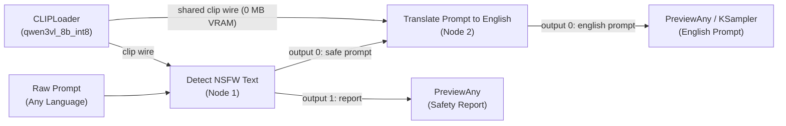
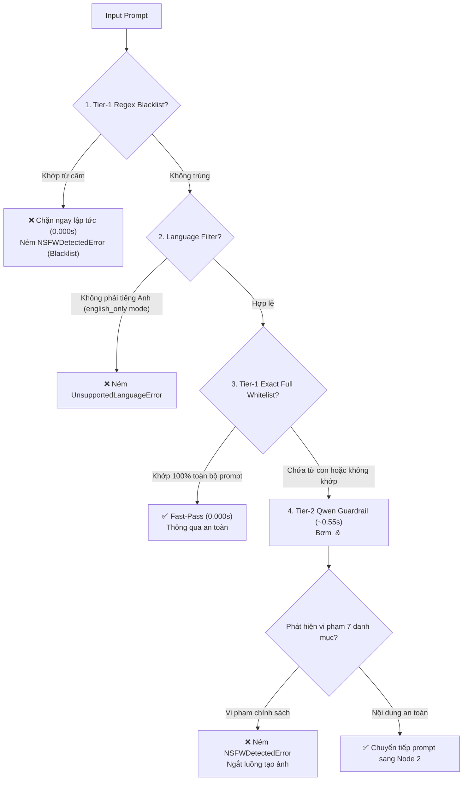

# ComfyUI-Detect-NSFW-Text 🛡️

[](https://github.com/comfyanonymous/ComfyUI)
[](https://huggingface.co/Qwen)
[](#key-features)
[](#key-features)
[](#alibaba-cloud-prompt-engineering)
[](LICENSE)

> **High-Speed, Multilingual AI Content Moderation & Prompt Translation Pipeline for ComfyUI powered by Qwen Guardrail.**

**ComfyUI-Detect-NSFW-Text** là bộ node kiểm duyệt an toàn nội dung (Prompt Moderation) và dịch thuật prompt chuyên sâu thế hệ mới dành cho ComfyUI. Được xây dựng trên kiến trúc **phòng thủ 2 lớp (Hybrid 2-Tier)** kết hợp mô hình thị giác-ngôn ngữ **Qwen3-VL-8B Int8**, bộ node cung cấp khả năng kiểm duyệt chính xác tuyệt đối, chống bypass thông minh và chuyển ngữ tiếng Anh chất lượng cao cho Stable Diffusion / FLUX.

---

## ⚡ Tính Năng Nổi Bật (Key Features)

- ⚡ **Tốc Độ Vượt Trội (~0.55s - 0.60s P50):** Tối ưu hóa prompt theo chuẩn Alibaba Cloud và tận dụng cơ chế chia sẻ dây mô hình `CLIPLoader` giúp tiết kiệm bộ nhớ, đạt độ trễ cực thấp.
- 🔗 **2-Node Production Pipeline (0 MB Extra VRAM):**
  - Node 1: **Detect NSFW Text** (`DetectNSFWText`) kiểm duyệt nội dung toàn diện 7 danh mục.
  - Node 2: **Translate Prompt to English** (`TranslatePromptToEnglish`) tự động phát hiện và dịch prompt đa ngôn ngữ sang tiếng Anh chuẩn, chia sẻ chung dây mô hình CLIP mà **không tốn thêm bất kỳ MB VRAM nào**.
- 🔒 **7 Danh Mục Kiểm Duyệt Toàn Diện (Bao Gồm MEDICAL):**
  1. `NSFW`: Khiêu dâm, dung tục, khỏa thân, hành vi tình dục.
  2. `GORE_VIOLENCE`: Bạo lực ghê rợn, máu me, cắt xẻ cơ thể, tra tấn, tự hại.
  3. `MEDICAL`: Chặn toàn bộ nội dung y tế, lâm sàng, phẫu thuật, mổ xẻ, vết thương, mô hình giải phẫu nội tạng, dụng cụ y tế, siêu âm, khám họng, đo huyết áp, tiêm truyền trên mọi ngôn ngữ qua chính sách (không cần sửa `blacklist.txt`).
  4. `WEAPONS_EXPLOSIVES`: Vũ khí tự chế, súng đạn, chất nổ, bom mìn.
  5. `CHILD_ABUSE`: Bóc lột, lạm dụng hoặc gây tổn hại đến trẻ vị thành niên.
  6. `ANIMAL_ABUSE`: Bạo hành, tra tấn hoặc kích động ngược đãi động vật.
  7. `BLACKLIST`: Khớp khái niệm ngữ nghĩa chính xác theo `<blacklist>`.
- 🛡️ **Vá Lỗ Hổng Whitelist Substring Bypass (Anti-Bypass Protection):**
  - Tier-1 Whitelist chỉ kích hoạt Fast-Pass (0.000s) khi **toàn bộ prompt đã chuẩn hóa khớp chính xác 100%** với từ khóa trong Whitelist.
  - Các trường hợp chứa từ khóa Whitelist dưới dạng chuỗi con (substring) bắt buộc phải chuyển sang Tier-2 Qwen Guardrail để phân tích ngữ cảnh, ngăn chặn hoàn toàn kỹ thuật tấn công chèn từ tin cậy để vượt rào.
- 📥 **Luôn Bơm Cả `<blacklist>` và `<whitelist>` Vào Prompt Guardrail:**
  - Mọi câu truy vấn gửi đến LLM đều chứa đầy đủ cả hai thẻ `<blacklist>` và `<whitelist>` (sử dụng `- none` nếu danh sách trống).
  - Quy tắc ghi đè nghiêm ngặt: `<blacklist>` và các danh mục 1-6 luôn có quyền ưu tiên tuyệt đối hơn `<whitelist>`.
- 🌐 **100% Pure English Alibaba Cloud Prompt Design:**
  - Prompt hệ thống được tinh giản (~260-280 tokens) theo cấu trúc chuẩn của Alibaba Cloud Model Studio: `#Role#`, `#Task Steps#`, `#Categories#`, `#Output#`, `#Examples#` với dấu phân cách đơn vị `###`.
  - Vô hiệu hóa suy nghĩ lan man bằng chỉ thị `/no_think` cho kết quả JSON nhất quán và độ trễ tối ưu.
- 🛑 **Cổng Chặn Anti-Spam / Anti-DoS Đầu Vào (2x Max Length - Wave-6.4):**
  - **Giới hạn ký tự thô:** `MAX_INPUT_CHARS = 3500` ký tự (chặn đứng O(1) các cuộc tấn công spam nhiều trang, emoji flood, hoặc chuỗi ký tự không khoảng trắng trong <0.05ms tại CPU).
  - **Giới hạn từ đầu vào (2x output budget):** `MAX_INPUT_WORDS = 500` từ hiệu dụng (`2 * MAX_TRANSLATE_WORDS`). Quy tắc tính chuẩn xác:
    - **1 ký tự CJK (Hán/Kanji/Kana) = 1.0 unit:** Dấu câu CJK toàn giác (`，`, `。`...) và dấu câu đính kèm tính 0.0 unit.
    - **<= 250 ký tự CJK:** Chuyển ngữ đầy đủ, giữ nguyên chi tiết.
    - **251 - 500 ký tự CJK:** Kiểm duyệt toàn diện 100%, dịch cô đọng súc tích trong phạm vi `<= 250` từ tiếng Anh / `800` max tokens.
    - **> 500 ký tự CJK hoặc > 500 từ:** Lập tức ném `PromptTooLongError` ngay tại CPU / trước GPU để chống spam/nghẽn bộ nhớ.
    - **Chữ Thái/Lào/Khmer/Myanmar:** 1 ký tự = 0.25 unit (~2.000 ký tự). Chữ Latinh: 1 token = 1.0 unit (~500 từ).
  - **Giới hạn token đầu vào (2x output token budget):** `MAX_INPUT_TOKENS = 1600` Qwen input tokens (`2 * TRANSLATE_MAX_TOKENS_CAP`). Kiểm tra siêu tốc với 0% overhead token hóa nếu chuỗi UTF-8 <= 1600 bytes.
  - Nếu vượt bất kỳ ngưỡng nào, hệ thống lập tức ném lỗi `PromptTooLongError` ngay tại CPU / trước khi sinh token GPU để chống nghẽn hệ thống.
- 🚀 **Tối Ưu Hóa Token Budget & KV-Cache (Wave-6.3 Production Lock-in):**
  - **Guardrail Token Cap:** `GUARDRAIL_MAX_TOKENS = 36` tokens (hiệu chuẩn từ GPU: 11 tokens Safe JSON, 13-17 tokens Vi phạm, 30 tokens worst-case có think tag + biên an toàn +20% backup; cắt giảm 44% đuôi KV-cache so với 64).
  - **Adaptive Translation Budget:** Giới hạn đầu ra `<= 250 words` (`MAX_TRANSLATE_WORDS = 250`), prefill đầu vào tối đa `MAX_PREFILL_INPUT_WORDS = 500` từ. Tự động bảo toàn đầy đủ các thẻ `<lora:...>` từ phần đuôi prompt mà không vượt trần 250 từ. Ngân sách token thích ứng `[36..800]` tokens (`TRANSLATE_MIN_TOKENS = 36`, `TRANSLATE_MAX_TOKENS_CAP = 800` kèm +20% backup margin bao phủ đỉnh 658 tokens ở tiếng Hàn 250 từ). Prompt kiểm duyệt gốc không bao giờ bị cắt ngắn để chống bypass.
- 🔄 **Realtime Hot-Reload:** Chỉnh sửa `blacklist.txt` hoặc `whitelist.txt` có **hiệu lực tức thì** mà không cần khởi động lại ComfyUI nhờ cơ chế `IS_CHANGED` tracking mtime và hash.

---

## 🏗️ Kiến Trúc Quy Trình 2 Node (2-Node Pipeline)



### Chi Tiết Xử Lý Nội Bộ Tại Node 1 (Detect NSFW Text)



---

## 🔒 7 Danh Mục Vi Phạm (Policy Categories)

| Danh Mục | Phạm Vi Nhận Diện & Quy Tắc Kiểm Duyệt |
| :--- | :--- |
| **`NSFW`** | Nội dung khiêu dâm, tình dục rõ ràng, khỏa thân dung tục, gạ gẫm tình dục. |
| **`GORE_VIOLENCE`** | Bạo lực cực đoan, máu me ghê rợn, cắt xẻ cơ thể, tra tấn dã man, tự hại. |
| **`MEDICAL`** | Toàn bộ cảnh tượng, thủ thuật y tế/lâm sàng/bệnh viện/phòng khám/nha khoa/thú y: phẫu thuật, mổ xẻ, vết rạch, chảy máu bệnh lý, chăm sóc vết thương/bỏng/gãy xương, mô hình giải phẫu nội tạng, dụng cụ y tế (dao mổ...), siêu âm, hồi sức tim phổi (CPR), tiêm truyền/vắc xin, đo huyết áp, bác sĩ khám bệnh (khám họng, băng bó...). Phân biệt bối cảnh hóa trang sân khấu/nghệ thuật lành tính là an toàn. |
| **`WEAPONS_EXPLOSIVES`** | Hướng dẫn chế tạo, sửa đổi hoặc sử dụng vũ khí tự chế, súng đạn, chất nổ, bom ống. |
| **`CHILD_ABUSE`** | Lạm dụng, bóc lột tình dục hoặc gây tổn hại đến thể xác/tinh thần trẻ vị thành niên. |
| **`ANIMAL_ABUSE`** | Hành vi tàn ác, tra tấn, kích động chọi chó/đá gà hoặc cố ý sát hại động vật. |
| **`BLACKLIST`** | Khái niệm cấm được chỉ định trong `<blacklist>` theo ngữ nghĩa chính xác đa ngôn ngữ (không chặn tượng có che phủ/quần áo khi cấm "nude statue", không chặn đồ tập gym/thể thao kín đáo khi cấm "bikini"). |

---

## 🌐 Thiết Kế Prompt Chuẩn Alibaba Cloud (Prompt Engineering)

Prompt hệ thống được xây dựng theo tài liệu hướng dẫn kỹ thuật prompt của Alibaba Cloud Model Studio:
- **Cấu trúc phân đoạn rõ ràng:** `#Role#`, `#Task Steps#`, `#Categories#`, `#Output#`, `#Examples#`.
- **Dấu phân cách đơn vị `###`:** Bao bọc xung quanh các thẻ XML `<blacklist>`, `<whitelist>`, `<user_input>` giúp mô hình định vị chính xác ranh giới dữ liệu và chống injection.
- **100% Pure ASCII English:** Đảm bảo tokenizer hoạt động tối ưu, không tiêu tốn thêm token đa byte cho chỉ dẫn hệ thống.
- **Fail-Closed Security:** Nếu JSON đầu ra bị lỗi cú pháp, có dấu hiệu mâu thuẫn (`blocked: false` nhưng có danh mục vi phạm) hoặc chứa mã bất thường, hệ thống tự động khóa an toàn (`Fail-Closed`).

---

## 📊 Hiệu Chuẩn Token Budget Trên GPU Thực Tế (Empirical GPU Token Budgets)

Kết quả đo lường thực nghiệm trực tiếp trên mô hình **Qwen3-VL-8B-INT8** (`real_token_measurement_gpu.json`) giúp tối ưu hóa chính xác bộ nhớ KV-Cache mà không làm đứt đoạn phản hồi:

### 1. Kiểm Duyệt An Toàn (`DetectNSFWText`)
| Trạng Thái Kiểm Duyệt | Số Token Đầu Ra Thực Tế (GPU) | Cấu Hình `GUARDRAIL_MAX_TOKENS` (+20% Headroom) |
| :--- | :--- | :--- |
| **Safe Output** (`{"blocked": false, "categories": []}`) | **11 tokens** | Giới hạn cứng: **36 tokens** |
| **Policy Violation** (`NSFW`, `MEDICAL`, `BLACKLIST`...) | **13 – 17 tokens** (17 max trên `WEAPONS_EXPLOSIVES`) | *(Trước đây: 64 tokens, tiết kiệm 44% bộ đệm KV-Cache)* |
| **Markdown Fenced / `<think>` Worst-Case** | **26 – 30 tokens** | Đảm bảo không bao giờ bị cắt ngắn JSON hợp lệ. |

### 2. Dịch Thuật Đa Ngôn Ngữ (`TranslatePromptToEnglish`)
- **Wrapper Template Overhead:** `_TRANSLATE_WRAPPER_EST_TOKENS = 335` tokens (khung ChatML + System Prompt).
- **Cổng Chặn Anti-Spam 2x Max Length:** `MAX_INPUT_CHARS = 3500` ký tự, `MAX_INPUT_WORDS = 500` từ hiệu dụng, `MAX_INPUT_TOKENS = 1600` Qwen input tokens (ném `PromptTooLongError` nếu vượt ngưỡng).
- **Quy tắc đếm từ thích ứng 1:1 CJK (`_truncate_to_max_words` & `_count_effective_words`):**
  - Chữ Hán / Kanji / Kana (`CJK`): **1 ký tự = 1.0 unit** (dấu câu toàn giác/đính kèm tính 0.0 unit).
    * `<= 250` CJK chars: Dịch đầy đủ nguyên vẹn.
    * `251 - 500` CJK chars: Kiểm duyệt toàn bộ nội dung, tự động cô đọng dưới trần `<= 250` words / `800` max tokens.
    * `> 500` CJK chars hoặc `> 500` words: Ném ngay `PromptTooLongError`.
  - Chữ Thái / Lào / Khmer / Myanmar: 1 ký tự = 0.25 unit (tối đa 2.000 ký tự).
  - Chữ Latinh / ký tự khác: 1 token khoảng trắng = 1.0 unit (tối đa 500 từ).
- **Hệ số giãn nở đa ngôn ngữ & Ngân sách Max Tokens:**
  - **Giới hạn sản xuất:** `MAX_TRANSLATE_WORDS = 250` (bao phủ >92-95% người dùng ComfyUI, tối ưu hóa triệt để thời gian sinh token).
  - **Đỉnh tiêu thụ GPU ở 250 từ:** Tiếng Hàn `KO_250w` đạt đỉnh **658 tokens** đầu ra. Với biên an toàn +20% (`BACKUP_TOKEN_MARGIN = 1.20`), trần token được đặt chính xác tại:
  - **Ngân Sách Áp Dụng:** `TRANSLATE_MIN_TOKENS = 36`, `TRANSLATE_MAX_TOKENS_CAP = 800` tokens (`TRANSLATE_BASE_MAX_TOKENS = 666`).

---

## 🚀 Cài Đặt & Khởi Động Nhanh (Quick Start)

### Bước 1: Cài đặt Custom Node
Di chuyển vào thư mục `ComfyUI/custom_nodes/`:
```bash
cd ComfyUI/custom_nodes
git clone https://github.com/comfyanonymous/comfyUI-detect-nsfw-text.git
cd comfyUI-detect-nsfw-text
pip install -r requirements.txt
```

### Bước 2: Tải mô hình Qwen Text Encoder
Tải mô hình Guardrail (khuyên dùng `qwen3vl_8b_int8_convrot.safetensors`) và đặt vào:
```
ComfyUI/models/clip/
# hoặc
ComfyUI/models/text_encoders/
```

### Bước 3: Nạp Workflow Chuẩn
Kéo thả trực tiếp file [workflow_nsfw_detect_example.json](workflow_nsfw_detect_example.json) vào giao diện ComfyUI để sử dụng chuỗi kiểm duyệt và dịch thuật 2 node đã được kết nối hoàn chỉnh.

---

## 🔌 Đặc Tả Các Node Trong Hệ Thống

### 1. Node `Detect NSFW Text` (`DetectNSFWText`)
- **Category:** `safety`
- **Inputs:**
  - `prompt` (`STRING`, bắt buộc, multiline): Prompt cần kiểm duyệt.
  - `clip_name` (`STRING`, mặc định: `qwen3vl_8b_int8_convrot.safetensors`).
  - `language_filter` (`all_languages` | `english_only`).
  - `clip` (`CLIP`, tùy chọn): Dây nối từ `CLIPLoader`.
  - `blacklist` (`STRING`, tùy chọn): Từ khóa cấm bổ sung trực tiếp trên UI.
  - `whitelist` (`STRING`, tùy chọn): Từ khóa tin cậy để Fast-Pass khi khớp 100%.
  - `translate_mode` (`none` | `merged_single_pass` | `two_step_internal`, mặc định: `none`).
- **Outputs:**
  - `prompt` (`STRING`): Prompt an toàn được chuyển tiếp.
  - `report` (`STRING`): Báo cáo JSON chi tiết (`blocked`, `categories`, `reason`).

### 2. Node `Translate Prompt to English` (`TranslatePromptToEnglish`)
- **Category:** `safety`
- **Inputs:**
  - `prompt` (`STRING`, bắt buộc, multiline): Prompt đầu vào từ Node kiểm duyệt hoặc text box.
  - `clip_name` (`STRING`, mặc định: `qwen3vl_8b_int8_convrot.safetensors`).
  - `clip` (`CLIP`, tùy chọn): Dùng chung dây nối từ `CLIPLoader` (0 MB VRAM overhead).
- **Outputs:**
  - `prompt` (`STRING`): Prompt tiếng Anh nguyên bản (nếu đã là tiếng Anh, xử lý tức thì trong 0.000s) hoặc prompt đã dịch trung thực giữ nguyên dấu ngoặc kép `"..."`, `{braces}`, và trọng số SD `(masterpiece:1.2)`.

---

## 📋 Mẫu Báo Cáo JSON (Audit Report Example)

### Khi nội dung an toàn (Passed):
```json
{
  "blocked": false,
  "categories": [],
  "reason": null
}
```

### Khi vi phạm chính sách an toàn (Blocked):
```json
{
  "blocked": true,
  "categories": ["MEDICAL"],
  "reason": "Violation: ['MEDICAL']"
}
```

### Khi kích hoạt Semantic Blacklist:
```json
{
  "blocked": true,
  "categories": ["BLACKLIST"],
  "reason": "Violation: ['BLACKLIST']"
}
```

---

## 🔄 Cấu Hình Hot-Reload (Blacklist & Whitelist)

Node hỗ trợ 2 file cấu hình nằm ngay trong thư mục node:
- **`blacklist.txt`:** Chứa từ khóa/khái niệm cấm (ví dụ: `bikini`, `breastfeeding`, `nude statue`).
- **`whitelist.txt`:** Chứa từ khóa/cụm từ tin cậy cho phép đi qua ngay lập tức khi toàn bộ prompt khớp chính xác.

💡 **Không cần khởi động lại ComfyUI:** Bạn có thể chỉnh sửa `blacklist.txt` / `whitelist.txt` bất kỳ lúc nào; ComfyUI sẽ tự động phát hiện mtime và áp dụng ngay lập tức!

---

## 🎨 Workflow Mẫu (Example Workflow)

Repo đi kèm sẵn file cấu hình workflow hoàn chỉnh hỗ trợ cả UI graph và API:
- [workflow_nsfw_detect_example.json](workflow_nsfw_detect_example.json)

Pipeline kết nối chuẩn:
`CLIPLoader` (Node 3) ➔ `Detect NSFW Text` (Node 1) ➔ `Translate Prompt to English` (Node 2) ➔ `PreviewAny` (Node 4 & Node 5).

---

## 📄 Bản Quyền (License)

Dự án được phân phối dưới giấy phép mã nguồn mở **MIT License**. Mọi đóng góp (Pull Request, Bug Report) đều được hoan nghênh!
